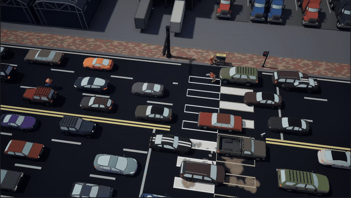
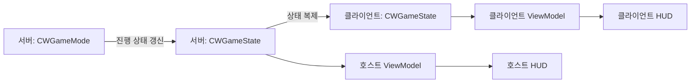

<div align="center">

# CROSSWALK

### 도로 위의 혼란을 함께 해결하는 1~4인 온라인 협동 파티 액션

**Unreal Engine 5.8 · C++ / Blueprint · Steam Multiplayer**



[출시용 게임 소개](https://github.com/NBcampUnrealTrack/8th-Team11-Final-Project/blob/codex/readme-steam-page/README.md) · [팀 노션](https://app.notion.com/p/teamsparta/8-11-CrossWalk-3b12dc3ef51480e1a725cf3e8956cd06)

</div>

## 프로젝트 개요

**Crosswalk**는 차량이 달리는 도로에서 동료들과 횡단보도를 완성하는 협동 게임입니다. 청소, 테두리 그리기, 도색, 뒷정리를 나눠 수행하며 차량 패링과 돌발 상황에 함께 대응합니다.

이 README는 프로젝트의 기술 구성과 구현 구조를 소개합니다. 플레이어를 위한 게임 소개와 작업별 GIF는 위의 **출시용 게임 소개**에서 볼 수 있습니다.

| 항목 | 내용 |
| --- | --- |
| 프로젝트 | Crosswalk / 크로스워크 |
| 팀 | 내일배움캠프 Unreal 트랙 8기 11조 |
| 장르 | 온라인 협동 파티 액션 |
| 플레이 인원 | 1~4인 |
| 시점 | 쿼터뷰 |
| 개발 대상 | Windows PC |
| 핵심 경험 | 역할 분담, 차량 패링, 도로 작업과 돌발 상황 대응 |

## 핵심 플레이

**도로 청소 → 테두리 그리기 → 흰색 도색 → 넘친 페인트 정리**

- **작업 분담**: 빗자루, 테두리 도구, 흰색·검은색 롤러를 사용해 횡단보도를 완성합니다.
- **차량 패링**: 다가오는 차량을 받아쳐 작업 공간을 확보합니다. 튕겨 나간 차량은 다른 플레이어에게도 위험이 됩니다.
- **보급과 휴식**: 도구의 페인트를 보충하고, 작업 중 올라가는 체온을 관리합니다.
- **돌발 상황**: 도로에 생긴 싱크홀을 아스팔트건으로 복구하며 작업을 이어갑니다.

## 기술 스택

| 영역 | 기술 | 프로젝트 내 활용 |
| --- | --- | --- |
| 게임 엔진 | Unreal Engine 5.8 | 게임플레이, 레벨, 렌더링, 네트워크 |
| 구현 | C++ · Blueprint | C++ 시스템과 Blueprint 콘텐츠·연출 구성 |
| 입력 | Enhanced Input | 캐릭터 이동 및 작업·상호작용 입력 |
| 멀티플레이 | Online Subsystem Steam · SteamSockets | Steam 세션 생성·검색·참가와 네트워크 연결 |
| 로컬 세션 개발 | Online Subsystem Null | 로컬 테스트용 온라인 서브시스템 의존성 |
| UI | UMG · Slate · ModelViewViewModel | 로비·HUD·설정 화면, 상태 바인딩, 커스텀 표시 |
| 이펙트 | Niagara | 게임플레이 시각 효과 |
| 도색 표현 | Decal · 동적 텍스처 · RHI | 도색 영역 표시 및 작업 상태 텍스처 갱신 |
| 렌더링 설정 | Lumen · Hardware Ray Tracing · Virtual Shadow Maps · Substrate | 프로젝트 조명·반사·그림자·머티리얼 설정 |
| 버전 관리 | Git · GitHub · Git LFS | 소스 협업 및 Unreal 애셋 관리 |
| 검증 | Unreal Automation Test | UI·세션·작업 표시 회귀 테스트 |

모듈 의존성은 [Crosswalk.Build.cs](Source/Crosswalk/Crosswalk.Build.cs), 엔진 버전과 활성 플러그인은 [Crosswalk.uproject](Crosswalk.uproject)에서 확인할 수 있습니다.

## 주요 시스템

| 시스템 | 담당 기능 | 구현 위치 |
| --- | --- | --- |
| 게임 진행 | 작업 목표, 스테이지 상태, 목표 달성 현황 공유 | [Core](Source/Crosswalk/Core) |
| 온라인 세션 | Steam 로그인, 공개 방 검색, 방 코드 참가, 세션 종료 | [CWGameInstance](Source/Crosswalk/Core/CWGameInstance.h) |
| 캐릭터 | 플레이어 조작과 컨트롤러 | [Characters](Source/Crosswalk/Characters) |
| 도로 작업 | 먼지 제거, 테두리 작업, 셀 도색, 도구·보급·체온 관리 | [Painting](Source/Crosswalk/Painting) |
| 교통·패링 | 차량 생성, 차선·정지선, 교통 난이도와 패링 | [Traffic](Source/Crosswalk/Traffic) |
| 싱크홀 | 생성 영역, 추락 처리, 아스팔트건과 투사체 | [Sinkhole](Source/Crosswalk/Sinkhole) |
| 날씨 | 날씨 액터와 제어 컴포넌트 | [Weather](Source/Crosswalk/Weather) |
| 화면·상호작용 | ViewModel, 위젯, 진행 표시, 상호작용 안내 | [UI](Source/Crosswalk/UI) · [Interaction](Source/Crosswalk/Interaction) |
| 사운드 | 오디오·음악 서브시스템 | [Audio](Source/Crosswalk/Audio) · [CWMusicSubsystem](Source/Crosswalk/Core/CWMusicSubsystem.h) |

### 멀티플레이와 상태 전달

호스트가 게임을 함께 실행하는 **리슨 서버** 방식으로 세션을 구성합니다. `CWGameInstance`가 방 생성·검색·참가를 관리하고, 게임 진행 상태는 `CWGameMode`와 `CWGameState`로 나누어 처리합니다.

아래는 작업 목표와 진행 상태가 HUD에 전달되는 흐름입니다.



`CWGameState`는 목표 목록, 완료 개수, 스테이지 상태를 복제하고 변경 이벤트를 제공합니다. UI에서는 GameState를 구독하는 ViewModel을 통해 표시 상태를 갱신합니다.

관련 구현: [CWGameMode](Source/Crosswalk/Core/CWGameMode.cpp) · [CWGameState](Source/Crosswalk/Core/CWGameState.h) · [CWBaseGameStateViewModel](Source/Crosswalk/UI/ViewModel/CWBaseGameStateViewModel.cpp) · [CWObjectiveViewModel](Source/Crosswalk/UI/ViewModel/CWObjectiveViewModel.cpp)

### 작업 영역과 플레이어 기능 분리

도로 작업 영역은 먼지, 테두리, 도색 셀에 따라 클래스를 나눕니다. 플레이어 측 기능은 작업, 도구 보유, 보급품 운반, 체온, 작업 조준점 등을 컴포넌트로 구성합니다.

- **작업 영역**: `CWWorkZone_Dust`, `CWWorkZone_BorderSketch`, `CWWorkZone_Cells`
- **플레이어 작업**: `CWWorkerComponent`, `CWToolHolderComponent`, `CWSupplyCarrierComponent`
- **작업 피드백**: `CWTemperatureComponent`, `CWWorkReticleComponent`, `CWWorkZoneHighlightComponent`

관련 구현: [Painting/Zone](Source/Crosswalk/Painting/Zone) · [Painting/Components](Source/Crosswalk/Painting/Components)

## 저장소 구조

```text
Crosswalk/
├─ Source/Crosswalk/
│  ├─ Core/           # 게임 진행, 세션, 로비, 스테이지
│  ├─ Characters/     # 플레이어 캐릭터와 컨트롤러
│  ├─ Painting/       # 도로 작업, 도구, 보급, 체온
│  ├─ Traffic/        # 차량, 교통 제어, 패링
│  ├─ Sinkhole/       # 싱크홀과 아스팔트 복구
│  ├─ Weather/        # 날씨
│  ├─ UI/             # ViewModel, 위젯, 화면, UI 테스트
│  ├─ Interaction/    # 상호작용 안내
│  ├─ Audio/          # 오디오 서브시스템
│  ├─ Data/           # 열거형, 구조체, 데이터 애셋
│  └─ Tests/          # 자동화 테스트
├─ Content/           # Blueprint, 맵, 게임 애셋
├─ Config/            # 프로젝트 설정
├─ Plugins/           # 프로젝트 플러그인
└─ Docs/Media/        # README 플레이 GIF
```

## 개발 환경과 실행

### 준비

- Unreal Engine **5.8**
- Unreal C++ 빌드 도구가 설치된 Visual Studio 및 Windows SDK
- Git 및 Git LFS
- 온라인 플레이 확인을 위한 Steam 클라이언트와 계정

### 프로젝트 받기

```powershell
git lfs install
git clone https://github.com/NBcampUnrealTrack/8th-Team11-Final-Project.git
cd 8th-Team11-Final-Project
git lfs pull
```

`.uasset`과 `.umap` 등은 Git LFS로 관리합니다. 애셋 다운로드가 끝나면 `Crosswalk.uproject`에서 프로젝트 파일을 생성하고, **Development Editor / Win64** 구성으로 빌드한 뒤 에디터를 실행합니다. 프로젝트에서 활성화한 플러그인도 해당 엔진 환경에 준비되어 있어야 합니다.

### 명령줄 빌드

프로젝트 루트의 PowerShell에서 실행합니다. `$EngineRoot`는 자신의 엔진 설치 경로로 바꾸세요. 빌드 전 에디터를 종료합니다.

```powershell
$EngineRoot = 'E:\UE_5.8'
& "$EngineRoot\Engine\Build\BatchFiles\Build.bat" CrosswalkEditor Win64 Development "-Project=$((Get-Location).Path)\Crosswalk.uproject" -WaitMutex
```

## 자동화 테스트

현재 소스에는 **13개의 자동화 테스트**가 등록되어 있습니다. 테스트 코드는 [Tests](Source/Crosswalk/Tests)와 [UI/Tests](Source/Crosswalk/UI/Tests)에 있습니다.

| 범위 | 주요 검증 대상 |
| --- | --- |
| 세션 | 방 검색 취소 처리 |
| 도로 작업 | 작업 조준점과 도색 일치, 기존 테두리 하이라이트 |
| 캐릭터 장착물 | 로비 이동과 잠금 상태에서의 수명 관리 |
| UI | 플레이어 이름, 도구 페인트 표시, 상호작용 안내, 확인창 |
| 진행·연출 | 클리어 신호 대기, 브러시 텍스트 렌더링, 스테이지 선택·클립보드 표시 |

테스트 이름은 `Crosswalk.*`로 시작합니다. 에디터용 테스트와 클라이언트용 테스트의 실행 컨텍스트가 구분되어 있습니다. 위 목록은 구현된 검증 범위이며 최신 실행 결과를 의미하지 않습니다.

## 팀 문서

- [8기 11조 Crosswalk — 프로젝트 소개 및 팀 문서](https://app.notion.com/p/teamsparta/8-11-CrossWalk-3b12dc3ef51480e1a725cf3e8956cd06)
- [출시용 README — 게임 소개와 작업별 플레이 영상](https://github.com/NBcampUnrealTrack/8th-Team11-Final-Project/blob/codex/readme-steam-page/README.md)

팀원별 역할과 제작 과정은 팀 노션에서 확인할 수 있습니다.
