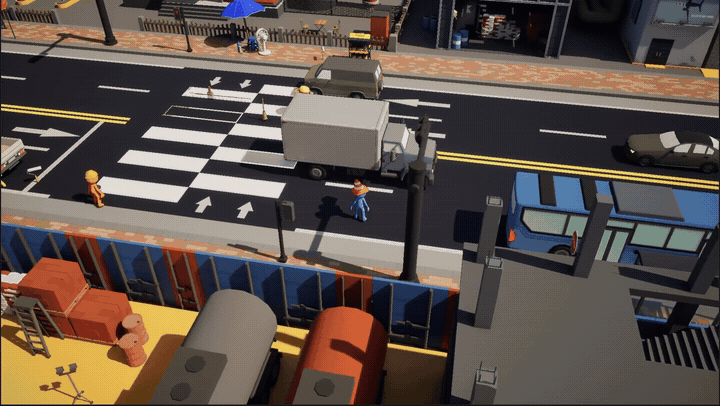
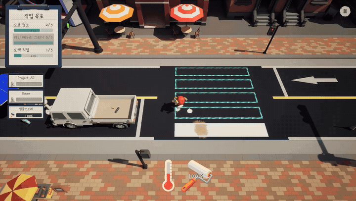
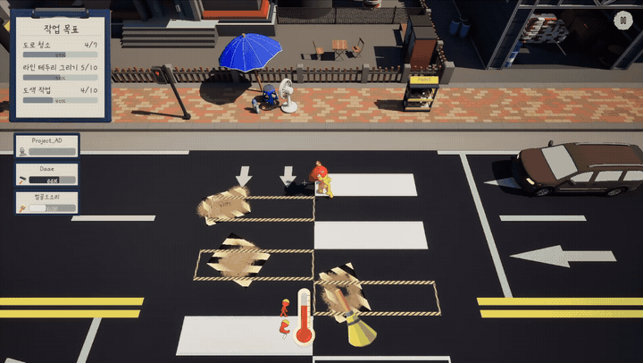
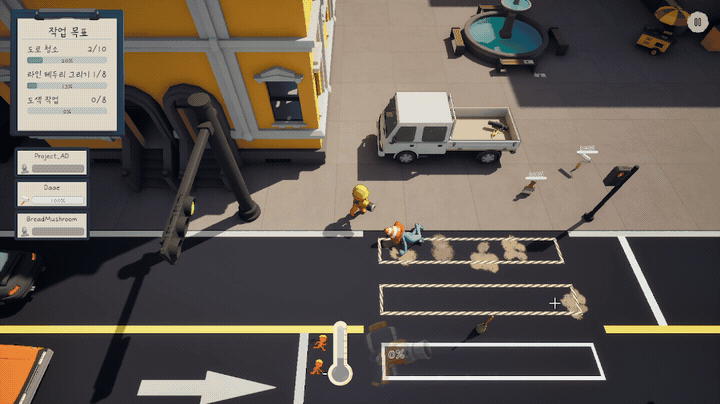

# CROSSWALK

### 횡단보도 하나 칠하는데, 이렇게까지 해야 한다고?

차는 달리고, 페인트는 떨어지고, 동료는 날아갑니다. 
친구들과 함께 도로 위의 난장판을 수습하는 **1~4인 온라인 협동 파티 액션 게임**.

**온라인 협동 · 파티 게임 · 액션 · 코미디**

[프로젝트 소개](https://app.notion.com/p/teamsparta/8-11-CrossWalk-3b12dc3ef51480e1a725cf3e8956cd06)

---

## 게임 정보

**오늘의 할 일: 횡단보도를 완성하세요. 물론, 차는 멈춰주지 않습니다.**

Crosswalk에서 여러분은 도로 작업반이 됩니다. 빗자루로 먼지를 쓸고, 테두리를 그리고, 롤러로 하얀 줄을 채워 넣으세요. 간단해 보이지만 작업에 정신이 팔린 사이에도 자동차는 끊임없이 달려옵니다.

혼자서 차근차근 완성해도 좋고, 친구들과 역할을 나눠 손발을 맞춰도 좋습니다. 다만 누군가 날아가는 순간, 방금 세운 계획은 다시 짜야 할지도 모릅니다!

 

### 차가 온다고요? 받아치세요!

달려오는 차를 피하거나, 충돌 직전 타이밍을 맞춰 패링하세요. 제대로 쳐낸 차는 조준한 방향으로 튕겨 나갑니다. 뒤에서 작업하던 친구를 지켜냈다면 훌륭한 팀워크죠.

**그 차가 다른 친구에게 날아가기 전까지는요.**

패링에 실패하면 도구를 떨어뜨린 채 멀리 날아갑니다. 날아간 곳에서 동료와 마주치더라도 너무 놀라지 마세요. 이 작업장에서는 흔한 일입니다.

 

### 한 명은 칠하고, 한 명은 나르고, 한 명은 “차 온다!”

한 사람이 들 수 있는 도구는 하나. 누군가는 도로를 청소하고, 누군가는 라인마킹카트로 테두리를 그려야 합니다. 안쪽을 하얗게 채웠다면 삐져나간 페인트까지 말끔하게 정리하세요.

페인트가 떨어진 동료에게는 새 페인트 통을 운반해 주세요. 차에 치여 통을 터뜨리면? 보급하러 왔다가 청소할 일만 늘어날 수도 있습니다. **일손이 모자란 곳을 찾아 움직이는 것까지가 여러분의 일입니다.**

 

### 뜨거워지는 건 우정만이 아닙니다

열심히 일할수록 체온이 올라 이동과 작업이 느려집니다. 잠시 의자에 앉아 열을 식히고, 동료에게 작업을 넘겨주세요.

문제는 **휴식 자리가 딱 한 명 몫**이라는 것. 누가 먼저 쉬고, 누가 남은 일을 맡을지 서로 이야기하세요. 쉬는 친구 쪽으로 차를 쳐내지 않는 배려도 잊지 마시고요.

 

### 방금까지 길이었는데요

도로 위에 갑자기 벌어진 싱크홀이 작업 동선을 가로막습니다. 돌아갈까요, 아니면 지금 메울까요? 아스팔트 건을 꺼내 구멍을 복구하고 동료가 지나갈 길을 확보하세요.

조준은 신중하게! 빗나간 아스팔트는 바닥에 끈적한 자국을 남겨 여러분과 동료의 발목을 잡습니다. 도로를 고치려다가 새 장애물을 만들지는 마세요.

 

### 완성은 함께, 다음 도전은 더 빠르게

제한 시간에 쫓겨 작업이 끝나지는 않습니다. 넘어지고, 흘리고, 돌아가더라도 끝까지 횡단보도를 완성하세요. 클리어 시간에 따라 별 등급이 결정됩니다.

첫 도전에서는 무사히 마무리하는 것을 목표로, 다음 도전에서는 역할과 동선을 맞춰 더 높은 등급에 도전하세요. **방금 그 사고만 없었어도 더 빨랐을 텐데!**

---

### 주요 특징

- **1~4인 플레이** — 혼자서도, 친구들과 온라인 협동으로도 즐기는 도로 작업.
- **차량 회피와 패링** — 작업을 계속할지, 피할지, 받아칠지 결정하는 아슬아슬한 순간.
- **네 단계의 횡단보도 작업** — 청소부터 테두리, 안쪽 도색, 페인트 정리까지.
- **계속 바뀌는 역할 분담** — 도구 교대, 페인트 보급, 휴식과 싱크홀 복구.
- **사고가 만드는 코미디** — 날아가는 동료와 쏟아진 페인트, 그리고 함께하는 뒷수습.
- **클리어 시간에 따른 별 등급** — 손발이 맞을수록 빨라지는 우리 팀의 작업.

 

**혼자 해도 재밌지만, 같이하면 더 재밌다.** 
오늘도 도로 위에서 만나요.

Unreal Engine 5.8 · 내일배움캠프 Unreal 8기 11조

